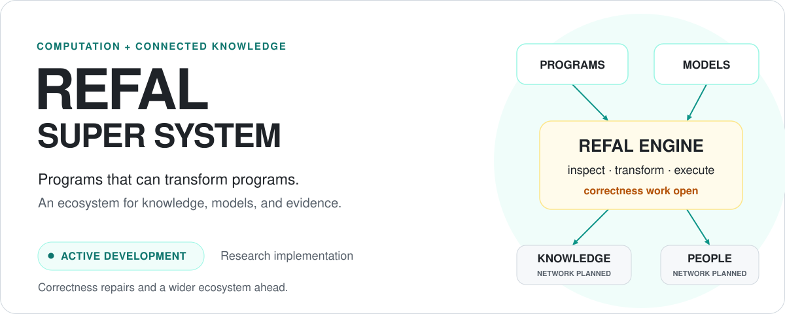
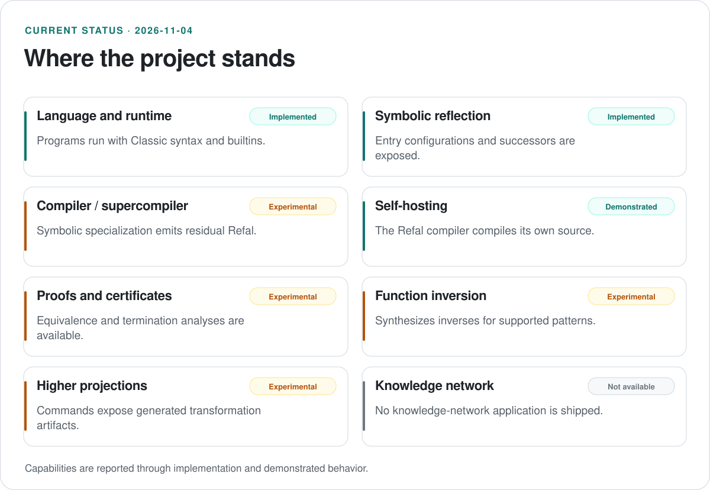
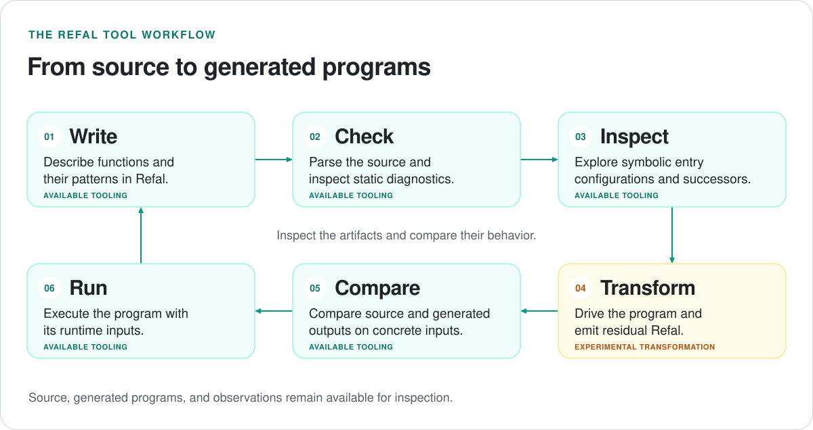

<div align="center">

<picture>
  <source media="(prefers-color-scheme: dark)" srcset="docs/images/ecosystem-hero-dark.svg">
  <source media="(prefers-color-scheme: light)" srcset="docs/images/ecosystem-hero-light.svg">
  
</picture>

[](https://github.com/Abhinav-Rust/REFAL-SUPERSYSTEM/actions/workflows/ci.yml)
[](LICENSE-MIT)
[](Cargo.toml)
[](#current-status)

**A Refal language system for transforming programs—and connecting knowledge to executable models and evidence.**

[What it is](#what-it-is) · [Current status](#current-status) · [Try it](#try-it) · [Tool workflow](#tool-workflow) · [Development](#development)

</div>

> [!NOTE]
> **Active research and development.** The project includes a Refal runtime, symbolic reflection, a supercompiler, and a compiler written in Refal. Transformation and analysis tools are experimental; generated programs and analysis results need validation within their intended use. The capability overview below describes the current implementation.

## What it is

Ordinary programs work on data. Refal also makes it natural to treat **programs themselves as data**: inspect their structure, follow their possible computations, specialize them for a known task, and emit a new program.

That is the computational foundation of this project. The wider goal, inspired by Valentin Turchin's work on metasystem transitions and Principia Cybernetica, connects those tools to a collaborative network of concepts, sources, formal models, and evidence. A claim should lead to its meaning, its source, and the computation or observation that supports it.

The repository currently provides a Rust bootstrap and runtime, a compiler written in Refal, symbolic transformation tools, and experimental proving and inversion. A shared knowledge-network application is not included in the current release.

## Current status

**Status reviewed:** 2026-11-04.

<picture>
  <source media="(prefers-color-scheme: dark)" srcset="docs/images/ecosystem-status-dark.svg">
  <source media="(prefers-color-scheme: light)" srcset="docs/images/ecosystem-status-light.svg">
  
</picture>

<details>
<summary><b>The capability ledger</b> — the same status in text</summary>

<!-- capability-status:start -->
| Capability | Status | What that means |
|---|---|---|
| Language and runtime | Implemented | Programs run with Classic syntax and builtins. |
| Symbolic reflection | Implemented | Entry configurations and successors are exposed. |
| Compiler / supercompiler | Experimental | Symbolic specialization emits residual Refal. |
| Self-hosting | Demonstrated | The Refal compiler compiles its own source. |
| Proofs and certificates | Experimental | Equivalence and termination analyses are available. |
| Function inversion | Experimental | Synthesizes inverses for supported patterns. |
| Higher projections | Experimental | Commands expose generated transformation artifacts. |
| Knowledge network | Not available | No knowledge-network application is shipped. |
<!-- capability-status:end -->

</details>

“Implemented” identifies an available capability; “demonstrated” identifies a concrete result. “Experimental” indicates evolving behavior and coverage. The repository's tests and reproducible examples define the evidence for each capability.

## Try it

Install a stable Rust toolchain, clone the repository, and run:

```bash
git clone https://github.com/Abhinav-Rust/REFAL-SUPERSYSTEM.git
cd REFAL-SUPERSYSTEM
cargo run --release -p refal -- run examples/hello.ref
cargo run --release -p refal -- metasystem examples/metasystem-unroll.ref
```

The first command runs a Refal program. The second specializes a small interpreter and compares its result with the original on the demonstration's inputs.

```text
Interpreter + known program
             ↓ specialize
Residual Refal program

Runtime steps:              172 → 4
Residual interpreter calls: 0
Inputs checked:             4
```

Those numbers describe this example. The transformation removes interpretive work and emits straight-line Refal; the [recorded run](docs/audits/2026-11-04/metasystem-demo.json) includes the generated program.

### A taste of Refal

Refal matches a sequence of symbols and terms, binds variables, and constructs a result. Here a function returns its input unchanged:

```refal
$EXTERN Prout;

$ENTRY Go {
  e.Input = <Prout <Identity e.Input>>;
}

Identity {
  e.Value = e.Value;
}
```

`s.` matches a symbol, `t.` a term, and `e.` a sequence. Parentheses group terms; angle brackets call functions. This structural vocabulary is also useful for writing interpreters and program transformers.

### Explore the tools

Use `cargo run --release -p refal --` before each command below, or build once and use the `refal` executable.

| Command | Purpose | Current boundary |
|---|---|---|
| `run <file.ref>` | Execute a Refal program | Bootstrap runtime and supported builtins. |
| `check <file.ref>` | Check syntax and semantics | Classic acceptance and documented diagnostic modes. |
| `reflect <file.ref>` | Inspect a symbolic entry configuration | A bounded report with explicit completeness. |
| `drive <file.ref>` | Follow computations | A bounded exploration. |
| `compile <file.ref>` | Emit transformed Refal | Experimental specialization; compare source and generated behavior. |
| `metasystem <interpreter.ref>` | Demonstrate specialization | Tested interpreter-elimination examples. |
| `prove <file.ref> <Predicate>` | Attempt a predicate proof | Experimental reasoning with explicit unresolved outcomes. |
| `prove <file.ref> --equiv <Left> <Right>` | Attempt an equivalence proof | Compares expressions over a shared argument pattern. |
| `feasibility <file.ref> --certificate` | Analyze feasibility and termination | Experimental analysis and certificate checking. |
| `invert <file.ref> <Function>` | Attempt inverse synthesis | Supported behavior and coverage remain incomplete. |
| `project2` / `project3` | Explore compiler-generation artifacts | Proper higher-projection staging is not established. |

### The self-hosting result

The compiler is itself a Refal program in [examples/compiler.ref](examples/compiler.ref). Tests run generated compiler generations and check a byte-stable result. A separate gate checks that driving actually transforms the compiler's dispatch.

Both generations are **115,023 bytes**, identical in the published driven fixpoint.

The fixpoint demonstrates self-hosting. Source/generated execution comparisons provide separate evidence for the semantics of transformed programs.

## Tool workflow

The command-line tools support a cycle of writing, checking, inspecting, transforming, comparing, and running Refal programs.

<picture>
  <source media="(prefers-color-scheme: dark)" srcset="docs/images/ecosystem-loop-dark.svg">
  <source media="(prefers-color-scheme: light)" srcset="docs/images/ecosystem-loop-light.svg">
  
</picture>

Turchin's 1996 metacomputation paper explicitly connects his computer-science work to metasystem transitions. *The Phenomenon of Science* describes formal scientific knowledge and machine assistance as conceptual and semantic work. The official Principia Cybernetica introduction describes a collaborative semantic network with different relationships and perspectives.

The [source catalog](docs/turchin/recovered/README.md) records publications, coauthors, editions, translations, URLs, and hashes for readers exploring these foundations.

## Development

Development is active across the language tools and their verification.

- **Equivalence checking** preserves shared free-variable identities and keeps terminal symbolic equations unresolved when structural equality does not establish them. Coverage includes all three variable kinds, nested results, repeated variables, and proof budgets.
- **Termination analysis** retains distinct call paths throughout size-change composition. Certificate checks reconstruct those paths from the source, with coverage for decreasing recursion, non-decreasing alternatives, and mutual recursion.
- **Function inversion** reconstructs source input patterns, preserving their order, repeated bindings, literals, and brackets. Round-trip tests cover repeated output values and fresh variable names; unsupported reconstruction cases return an explicit error.

## For contributors

The workspace separates syntax (`refal-ast`, `refal-syntax`), checks (`refal-semantics`), execution (`refal-runtime`), transformations (`refal-core`), the CLI (`refal`), and tooling (`xtask`). The Refal-authored compiler is retained alongside the Rust bootstrap so their behavior can be compared.

```bash
cargo fmt --check
cargo clippy --all-targets -- -D warnings
cargo test --profile test-fast --all -j 2 -- --test-threads=1
cargo xtask gen-readme-diagrams
```

The full suite runs serially because its self-hosting tests are expensive. The custom profile keeps debug assertions and overflow checks while using optimized execution. Focused tests exercise individual semantic rules; integration tests cover the CLI and self-hosting workflows.

The status panel is generated from the capability ledger above, so its light and dark variants share the same descriptions. Development conventions are documented in [CONTRIBUTING.md](CONTRIBUTING.md).

| Read more | What it covers |
|---|---|
| [Primary-source catalog](docs/turchin/recovered/README.md) | Verified source editions and reproducible retrieval. |
| [Language scope](docs/LANGUAGE-SCOPE.md) | The Classic Refal-5 target. |
| [Frontend coverage](docs/FRONTEND-COVERAGE.md) | Syntax clauses and fixtures. |
| [Verification contract](docs/VERIFICATION-CONTRACT.md) | Diagnostic design and verification terminology. |
| [Contributing](CONTRIBUTING.md) | Development conventions. |

Project code is [MIT licensed](LICENSE-MIT). Third-party publications retain their own rights and are referenced through the source catalog.
