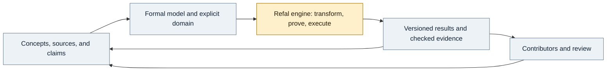

**REFAL-SUPERSYSTEM has a substantial computational implementation, but its previously advertised 93.8% completion does not describe a trustworthy, complete ecosystem.** The compiler, runtime, transformation machinery, and self-hosting work are real. Reproducible correctness failures prevent treating the compiler, prover, termination certificates, and inversion as finished. The shared knowledge network the owner explicitly included in the goal has not been implemented.

Assessment date: **4 November 2026**. Repository: [Abhinav-Rust/REFAL-SUPERSYSTEM](https://github.com/Abhinav-Rust/REFAL-SUPERSYSTEM). Assessed revision: [`c8f95421350b6d7d50a01e83278da4a33fae3b61`](https://github.com/Abhinav-Rust/REFAL-SUPERSYSTEM/tree/c8f95421350b6d7d50a01e83278da4a33fae3b61), clean `main`, workspace version `0.10.0`.

The owner's clarification, **“Include the knowledge network in the full ecosystem,”** governs this assessment. The assessed revision excluded that network. The updated README includes it as a remaining workstream; the older conformance ledger is marked historical and requires reconciliation.

The audit inventoried the code and collection, inspected the central implementation paths and their tests, compared published completion claims with what their gates actually assert, exercised the CLI, and built executable counterexamples. Load-bearing historical claims were checked against recovered source editions. The conclusions are bounded by those observations; neither the code inventory nor a passing test corpus is a proof of correctness for every accepted program. The 80 thematic HTML files are not presented here as 80 authenticated primary texts read in full.

All assessment fixtures, transcripts, and regression tests are in this directory. Published transcripts normalize local absolute paths; observed outputs and verdicts are preserved. Recovered source editions are documented in [the originals index](../../turchin/recovered/README.md), with a downloader for the local publication cache. The compiler/runtime implementation was left unchanged. At the owner's request, this update versions the audit deliverables, source catalog, and visual README together for publication on `main`.

---

**How much is actually built?** The language substrate is well advanced. The computational metasystem is a substantial research implementation with unresolved soundness problems. The full knowledge ecosystem still needs a major product and integration workstream.

The checkout contains **seven Rust workspace crates, 19 Rust files with 39,746 lines, 109 Refal files, and 434 Rust test functions** marked `#[test]`. These totals include tests and tooling. The Refal-authored compiler itself is **4,885 lines / 179,328 bytes**. Cargo dependencies are confined to workspace crates. This is considerable implemented machinery; line counts measure its scale, not its completion.

| Area | What exists and was evidenced | Assessment | What remains |
|---|---|---|---|
| Refal syntax and AST | Lexer/parser; `s.`, `t.`, and `e.` variables; structural expressions; conditions; declarations; Classic syntax and negative fixtures | Substantial working foundation | Preserve clause coverage and verify compatibility with an independent Refal implementation; do not equate a finite corpus with universal compatibility. |
| Runtime and matching | Expression representation, repeated-variable matching, evaluation, builtins, file I/O, metacodes, work-list execution, and runtime tests | Substantial working foundation | Continued independent semantic checks and performance work. The audit found no new runtime counterexample, but did not prove this layer complete. |
| Static checks | Name/binding checks, dead-sentence and recognition/domain diagnostics, feasibility analysis | Useful implementation, mixed trust | Keep ordinary checks; repair unsound termination analysis and align the published guarantee with what is actually established. |
| Reflection | Public `FrozenConfiguration`/`ReflectionReport` API and `refal reflect`; inspected entry and successor configurations | Working symbolic reflection service | Broader composition and contracts between tools. Its API inspects a symbolic entry graph; a general resumable live-runtime snapshot facility is not established by this gate. |
| Supercompilation | Symbolic driving, graph cleanup, partitions, generalization, folding, residual Refal, strategy search | Substantial implementation with a correctness blocker | Repair symbolic condition handling; broaden semantic differential testing; complete the acknowledged transformation/search research. |
| Refal-authored compiler | Lexer, parser, checker, driving, and code emission in `examples/compiler.ref`; compiler-of-compiler and fixpoint gates | Real self-hosting work, currently unsafe to call finished | Repair wrong-code generation. Compiler self-application remains expensive; existing documentation reports minutes on its own source. |
| Predicate/equivalence proving | CLI/API, proof leaves, relational equality, induction/folding demonstrations | Implemented but unsound | Free-variable identity, sound handling of undecided conditions, checked proof evidence, actual counterexample inputs, and richer generalization/relations. |
| Termination certificates | Size-change analysis, certificate output, certificate rechecking | Implemented but unsound | Preserve all relevant call-path alternatives; correct closure/subsumption and use a checker that does not merely repeat the same unsound reasoning. |
| Function inversion | An emitted inverse artifact and successful narrow examples | Partial synthesis with a correctness blocker | Reconstruct original input bindings/structure; define supported domains and non-injective behavior; check round trips and output coverage. |
| Metasystem transition / first projection | An interpreter specializes to a smaller target; measured example removes interpreter calls | Demonstrated on concrete examples | Expand language/input coverage after correctness repairs; maintain explicit semantic and cost evidence. |
| Second/third projections | `project2` and `project3` commands produce runnable artifacts | Claimed staging has not been demonstrated | Implement and test interpreter → compiler → target staging; the present gates check weaker transformations. |
| Stratified metaprogramming | Runtime-level metavariable machinery and metacodes; repository itself keeps E-17 partial | Partial | The transformer's own variable levels, staged substitutions, and evidence that levels cannot be conflated. |
| Shared knowledge network | Source documents and project documentation | Not implemented as a product | Persistent concepts/claims/provenance, collaborative revision, navigation/search, and executable-model/proof integration. |
| Distribution and practical backends | CI, release/checklist machinery, version metadata, interpreter and source-to-source output | Engineering foundation | No GitHub releases or tags existed when checked. A native backend is named in `docs/ARCHITECTURE.md` but absent from the implementation; reconcile that older plan with the intended release. |

A positive result worth preserving: `refal metasystem examples/metasystem-unroll.ref` reported **172 → 4 runtime steps**, no residual interpreter calls, and agreement on **four tested inputs**. The [saved transcript](metasystem-demo.json) contains the emitted straight-line Refal. [Reflection](reflection-demo.json) also worked on the identity example. These demonstrate useful behavior on the tested inputs. The prover's successful demonstration outputs do not independently validate their proofs given the false-proof counterexample below.

---

**The former percentage needs a new denominator and new evidence.** At the assessed revision, the README reported 93.8% across twelve weighted workstreams and a separate ledger of **21 closed, four partial, and one excluded** ecosystem rows. Those were the repository's own accounting results, not this audit's findings. The updated README withdraws the overall score.

There are three material problems with using that figure for your goal:

1. **The requested knowledge network was excluded.** E-26 is explicitly out of scope in the baseline conformance document. It must become an unimplemented, in-scope workstream. A major missing product cannot be represented by the former “about 6.2% left.”
2. **Several credits rely on invalid conclusions.** A compiler that changes a program's answer and a checker that certifies an unconditional loop cannot retain their current completion claims merely because their existing gates are green. E-15 inversion and E-14 projections need reopening. Driving/emission claims in E-5/E-9 need corrected semantic evidence; E-12/E-13 proving has a soundness problem in addition to its admitted incompleteness.
3. **The gates sometimes measure less than the prose claims.** The compiled-output differential gate covers 21 explicitly listed examples, while the README says every program in the corpus. Compiler normalization/fixpoint checks and Rust-versus-Refal parity do not substitute for comparing source behavior with generated-program behavior. The higher-projection gates likewise do not establish the claimed stage boundaries.

I would therefore classify the repository as **an advanced computational prototype requiring correctness repair, with the wider collaborative ecosystem still to be built**. There is no defensible replacement percentage without a bounded release scope and agreed weights. Simply subtracting failed rows would also mislead because the rows overlap and have very different sizes.

The philosophical rows also need careful interpretation. For example, E-22 maps predictive truth to a compiler differential check, E-23 maps invariants of action to shared-memory representation tests, and E-24 maps the imperative of truth to consistent version/progress reporting. These are local engineering interpretations of the ideas. Passing those tests does not establish the broader knowledge-building capabilities you intend. Keep the principles, and give their ecosystem applications their own observable requirements.

For future accounting, include every agreed workstream from the start, including those not begun; state its observable completion gate and supported domain; and record implementation, evidence, and remaining limitations separately. A sound but incomplete prover can be a completed feature within a stated contract. An incorrect proof is a failed contract.

---

**Five executable correctness failures were reproduced.** The [standalone regression suite](regression_tests.rs) asserts the required behavior and currently has **zero passes and five failures**; see the [full output, including assertion details](regression-output.txt) and [result metadata](regression-tests-result.json). The compiler and predicate failures appear to share the symbolic-condition problem, so these are five observable failures rather than a claim of five unrelated root causes.

The commands below run from the `REFAL-SUPERSYSTEM/` checkout after the `test-fast` binary has been built. Fixtures live next to this report under `docs/audits/2026-11-04/`.

**F1 — Compilation changes a valid program's answer. Treat this as a release blocker.**

```bash
target/test-fast/refal differential examples/prove-append-reach.ref --compiled
```

The command exits with failure and reports:

```text
differential mismatch
original:    ["True"]
transformed: ["False"]
```

This uses an existing tracked example, not an exotic new language feature. Direct execution returned `True` for the empty input and the other sampled inputs. Its compiled residue instead prints `False` unconditionally. The [generated program](predicate-compiled.ref) and [differential transcript](compiler-wrong-code.json) preserve the evidence.

The relevant path is symbolic invocation and condition matching in [`refal-core`](https://github.com/Abhinav-Rust/REFAL-SUPERSYSTEM/blob/c8f95421350b6d7d50a01e83278da4a33fae3b61/crates/refal-core/src/lib.rs#L1732) and [`match_symbolic_conditions`](https://github.com/Abhinav-Rust/REFAL-SUPERSYSTEM/blob/c8f95421350b6d7d50a01e83278da4a33fae3b61/crates/refal-core/src/lib.rs#L2461). Deferred symbolic evaluation is being treated as a failed condition in this case. Repair must preserve the condition or partition it soundly, retaining source sentence order and fallback semantics.

The omission is visible in [`compiled_programs_are_deployable_and_output_equivalent_across_the_corpus`](https://github.com/Abhinav-Rust/REFAL-SUPERSYSTEM/blob/c8f95421350b6d7d50a01e83278da4a33fae3b61/crates/refal-cli/tests/check_examples.rs#L4445): its list has 21 examples and does not include this fixture. A generated program can be valid Refal and a byte-stable fixpoint while computing the wrong answer.

**F2 — The equivalence prover proves two different free arguments equal. Treat this as a soundness blocker.**

The [fixture](equivalence-counterexample.ref) contains:

```refal
Left  { (e.X) (e.Y) = e.X; }
Right { (e.X) (e.Y) = e.Y; }
```

```bash
target/test-fast/refal prove docs/audits/2026-11-04/equivalence-counterexample.ref --equiv Left Right
target/test-fast/refal run docs/audits/2026-11-04/equivalence-counterexample.ref a b
```

The first command reports **`verdict: proved`, zero steps, reflexive**. The second prints `a` and `b` on separate lines. The functions disagree in the same environment. [Proof transcript](equivalence-false-proof.json); [concrete execution](equivalence-ground.json).

The reflexivity rule calls [`sequences_alpha_equal` on the two sides](https://github.com/Abhinav-Rust/REFAL-SUPERSYSTEM/blob/c8f95421350b6d7d50a01e83278da4a33fae3b61/crates/refal-core/src/lib.rs#L6705). Renaming one free input into another loses their shared meaning. Reflexivity must preserve the identities of free variables in the common environment. Renaming used for recurrence must be justified over the whole configuration/equation. The other induction and closing rules should be reviewed before restoring trust in positive proof verdicts.

**F3 — An infinite loop receives a rechecked termination certificate. Treat this as a soundness blocker.**

The [fixture](termination-counterexample.ref) is:

```refal
$ENTRY Go { = <Loop ('b')>; }
Loop {
  ('a' e.Rest) = <Loop (e.Rest)>;
  (e.Rest) = <Loop (e.Rest)>;
}
```

```bash
target/test-fast/refal feasibility docs/audits/2026-11-04/termination-counterexample.ref --certificate
```

The output includes `terminates Go`, `terminates Loop`, and **`# checked: every claim re-verified`**. But `Loop ('b')` takes the second sentence and rewrites to exactly itself forever. A bounded ground drive also exhausts its budget. [Certificate transcript](termination-feasibility.json); [bounded execution](termination-drive.json).

The size-change [`dominates` relation](https://github.com/Abhinav-Rust/REFAL-SUPERSYSTEM/blob/c8f95421350b6d7d50a01e83278da4a33fae3b61/crates/refal-semantics/src/feasibility.rs#L1102) and [closure construction](https://github.com/Abhinav-Rust/REFAL-SUPERSYSTEM/blob/c8f95421350b6d7d50a01e83278da4a33fae3b61/crates/refal-semantics/src/feasibility.rs#L1460) retain a stronger decreasing graph while discarding a weaker graph representing a possible non-decreasing call path. Proving all paths terminate requires preserving the adverse alternatives. Re-running that same unsound analysis in the certificate checker does not validate the certificate independently.

**F4 — The synthesized inverse fails a round trip for an injective encoder.**

The [forward function](inverse-duplicate-counterexample.ref) records every symbol twice:

```refal
Encode {
  = 'Nil';
  s.A e.Rest = 'Cons' s.A s.A <Encode e.Rest>;
}
```

```bash
target/test-fast/refal invert docs/audits/2026-11-04/inverse-duplicate-counterexample.ref Encode --strategy interpretive
target/test-fast/refal run docs/audits/2026-11-04/inverse-duplicate-roundtrip.ref
```

Inversion reports **complete / synthesized**, but the emitted inverse returns both occurrences of the bound symbol. Consequently `inverse(Encode('ab'))` produces **`aabb`**, where the required answer is `ab`. [Synthesis transcript](inverse-duplicate.json); [generated inverse](inverse-duplicate-generated.ref); [round-trip result](inverse-duplicate-roundtrip.json).

[`synthesize_inverse_program`](https://github.com/Abhinav-Rust/REFAL-SUPERSYSTEM/blob/c8f95421350b6d7d50a01e83278da4a33fae3b61/crates/refal-core/src/lib.rs#L8098) builds the reconstructed input by collecting variable occurrences in an output prefix. An inverse needs the original input structure and binding correspondence; output multiplicity need not equal input multiplicity. Completing a bounded drive also does not establish complete inverse coverage. Unsupported or non-injective cases need an explicit relational/domain contract.

**F5 — The predicate prover reports a true fixture as refuted.**

```bash
target/test-fast/refal prove examples/prove-append-reach.ref Law --steps 2000
```

The result is **complete / `refuted ('F' 'a' 'l' 's' 'e')`**, despite the direct executions producing `True`. [Proof transcript](predicate-associativity.json); [ground observations](ground-associativity.json).

The [fixture's own comments](https://github.com/Abhinav-Rust/REFAL-SUPERSYSTEM/blob/c8f95421350b6d7d50a01e83278da4a33fae3b61/examples/prove-append-reach.ref#L15) and [`prove_predicate`](https://github.com/Abhinav-Rust/REFAL-SUPERSYSTEM/blob/c8f95421350b6d7d50a01e83278da4a33fae3b61/crates/refal-core/src/lib.rs#L6136) describe the false refutation as an honest limitation. It is a semantic error: inability to decide a symbolic condition warrants an open/unknown result. A closed exploration of an unsoundly simplified graph cannot establish a counterexample. The reported string `False` is also an outcome, not an input a user can replay to refute the law.

The correct gate should require every reported refutation to carry a satisfying input substitution/path that reproduces the failure under concrete execution. Positive proofs require sound transformations and closing rules. This is a stronger and more useful contract than checking whether the exploration used fewer than its allowed steps.

---

**The higher Futamura projection claims need to be separated from the genuine self-hosting achievements.** This finding follows from the source and the test's actual input/output stages.

Let `S` be a specializer, `I` an interpreter, `P` an object program, and `D` runtime data. Specialization notation below omits representation details and assumes the appropriate static/dynamic staging.

| Construction | Required artifact boundary | What the current evidence establishes |
|---|---|---|
| First projection: `S(I, P)` | A target program that subsequently accepts `D` | Concrete interpreter-elimination demonstrations establish this for their tested examples. |
| Second projection: `S(S, I)` | A compiler fixed to `I`; later `compiler(P)` emits a target | `project2` drives a selected function with its program/input components free. Running it over the compiler's dispatcher produces a transformed dispatcher. This does not establish specialization of the specializer with a fixed interpreter. |
| Third projection: `S(S, S)` | A generator; `generator(I)` emits a compiler, and only later `compiler(P)` emits a target | `project3` fixes a mode and leaves both interpreter and program as inputs. The gate supplies both and compares the emitted target with a direct `SPECIALISE` result. The intermediate compiler stage is missing from the demonstration. |

The comment immediately preceding [`project_compiler`](https://github.com/Abhinav-Rust/REFAL-SUPERSYSTEM/blob/c8f95421350b6d7d50a01e83278da4a33fae3b61/crates/refal-core/src/lib.rs#L7850) explicitly says that proper `mix(mix, int)` is a different construction and is not built there. [`project_generator`](https://github.com/Abhinav-Rust/REFAL-SUPERSYSTEM/blob/c8f95421350b6d7d50a01e83278da4a33fae3b61/crates/refal-core/src/lib.rs#L7959) constructs an entry with fixed mode and free `Interpreter` and `Program`.

The [third-projection gate](https://github.com/Abhinav-Rust/REFAL-SUPERSYSTEM/blob/c8f95421350b6d7d50a01e83278da4a33fae3b61/crates/refal-cli/tests/check_examples.rs#L8428) requires those two inputs, compares its output to `compiler.ref SPECIALISE <template> <program>`, and runs the resulting target. That is useful specialization evidence, but it does not show `generator(I) → compiler` followed by `compiler(P) → target`.

The recovered [1996 self-application paper](<http://refal.botik.ru/library/Nemytykh-Pinchuk-Turchin_A_Self-Applicable_Supercompiler_(LNCS_vol_1110,_1996,_pp_322-337).pdf>), PDF page 10, directly explains why keeping program and data at the same level yields an interpreter again and how raising the program variable changes the stage boundary. This is a substantive semantic distinction in the source literature.

A completion gate should emit and save all three artifacts, run the generated compiler without supplying the interpreter again, and run the generated target without supplying its source program. Use at least two small interpreters and several programs/data cases, keeping stage inputs explicit. Preserve the existing self-hosting and dispatcher-specialization tests for the capabilities they do establish.

---

**Your reading of Turchin's wider purpose is supported by primary sources.** His 1996 metacomputation paper says he began with metasystem transition and that his subsequent CS work applied and concretized that idea. The connection between the philosophy and the computational machinery is explicit in the original text.

| Source checked | Relevant idea | Consequence for this project |
|---|---|---|
| *Metacomputation: MST plus SCP*, PDF pp. 1–2 | Systems become objects of higher-level examination, control, modification, and reproduction; Refal serves metasystem hierarchies | Programs and transformations should compose as inspectable, manipulable objects. Isolated demonstrations are only part of the intended capability. |
| *The Phenomenon of Science*, PDF pp. 244–245 | Formalizing scientific language is a conceptual/semantic task; formalization supports organizing knowledge, planning research, and machine assistance while human creative work continues | A document library alone does not implement the vision. Concepts need explicit meanings and connections to models, observations, and computational operations. |
| *On Cybernetic Epistemology*, English TeX introduction | Meaning is analyzed through prediction and action; the text uses a concept/node structure | Model concepts, claims, and their meaning explicitly. Preserve distinctions between a quoted assertion, a formal statement, a prediction, an observation, and a checked theorem. |
| Official *Introduction to Principia Cybernetica* | A semantic network with different relationships, worldwide collaborators, variation/selection, and adaptation to users | Shared editing, typed links, revisions, review, navigation, and different views belong in the product scope. |
| *The Cybernetic Manifesto* | Knowledge as predictive models, coupled with integration and freedom | Preserve contributors' agency, attribution, and differing viewpoints while enabling shared work and evidence-based revision. |

These sources motivate the architecture. They do not uniquely prescribe a contemporary database, interface, or set of service boundaries. The following requirements are an engineering interpretation of the literature and your scope.

The repository currently has no persistent knowledge model, claim/source provenance schema, collaborative knowledge revision workflow, network service, user interface for such a network, or integration attaching knowledge claims to versioned executable Refal models and their evidence. The computational state graph and the source-document collection provide ingredients for that work.

| Knowledge-network workstream | Minimum useful capability | Concrete completion evidence |
|---|---|---|
| Concepts and claims | Persistent identifiers and typed nodes for concepts, claims, definitions, sources, programs, and evidence; typed relationships between them | Create, query, export, and reopen a small curated domain after a restart, preserving links and identities. |
| Provenance | Exact source edition, author, page/passage, content hash, and distinction between original text, translation, quotation, and interpretation | Every imported foundational claim can be traced to its source and revision; an interpretation cannot silently become a quotation. |
| Executable meaning | Link a claim to a formal Refal model with an explicit domain and input/output meaning | A user can inspect the informal claim, its formalization, and the code/version used to evaluate it. |
| Proofs and experiments | Store reproducible runs, outputs, proof objects/checker results, and counterexample inputs | A saved result replays; proof, empirical agreement, refutation, and unknown remain distinguishable; changing a dependency marks prior evidence stale. |
| Collaboration | Contributor identity, attribution, history, proposals/review, and preserved alternatives | Two contributors revise the same concept, resolve or retain a disagreement, and recover the previous revision. |
| Navigation and views | Search, concept/relationship browsing, citation inspection, and views suited to different users | A reader can move from a claim to its sources, model, dependencies, and evidence without needing internal CLI knowledge. |
| The integrated research loop | Move from a concept to a formal model, transformation/proof attempt, concrete observation, and reviewed revision | One complete example runs through the network and engine, with every artifact linked and reproducible. |

The intended integration can be pictured as a loop. Most of the current implementation sits in the computational-engine node; the surrounding knowledge and collaboration facilities remain to be built.



A bounded first ecosystem release could use a small domain of symbolic list processing or elementary computational models. It should include a true claim, a false claim with a replayable counterexample, and an unresolved claim; more than one contributor; a revision that invalidates evidence; and a repeatable concept → model → computation → evidence → revision workflow. That gives the ecosystem a finite completion criterion while the broader research program remains open-ended.

---

**The source collection needs provenance repair before it can serve as the architectural authority.** The older thematic collection contains 25 CS, 34 philosophical/cybernetic, 12 physics, and nine sociopolitical HTML files. The repository's conformance document acknowledges that these are derived archival expositions, but later treats passages from them as precise quotations and an exact four-ring architecture.

Three checks illustrate the problem:

- The [existing book exposition](collection-comparison.json) labels chapter 1 “From Molecule to Man” and chapter 9 “The Thinking Machine.” The recovered book labels them “The Initial Stages of Evolution” and “Mathematics Before the Greeks.” That exposition is not a reliable transcription of the book. PDF/print page-count differences alone would not establish this; the differing contents do.
- The [1996 self-application exposition](collection-comparison.json) describes binding-time stratification, bounded homeomorphic whistles, and two-stage folding as the key innovations. The actual paper's abstract identifies flat Refal, pattern-matching graphs, and metasystem jumps. Source-based architectural decisions need the actual paper.
- The alleged [1991 supersystem report](collection-comparison.json) and its exact four-concentric-ring wording have not been authenticated against an original publication in this audit. The bibliographic search did not establish nonexistence. Keep the attribution explicitly unverified until an original is found; do not make it a premise for excluding the knowledge network.

The conformance document's [method caveat](https://github.com/Abhinav-Rust/REFAL-SUPERSYSTEM/blob/c8f95421350b6d7d50a01e83278da4a33fae3b61/docs/TURCHIN-ECOSYSTEM-CONFORMANCE.md#L38) should govern its later attributions. Checking a purported 1986 quotation against another derived HTML file does not constitute checking the primary publication.

I added **nine source files covering eight works**, with an [index](../../turchin/recovered/README.md) and [provenance manifest](../../turchin/recovered/sources.json). They include the authentic book, manifesto, metacomputation and self-application papers, scanned metavariables report, official PCP introduction, dialogue, and both the English TeX and a labelled Russian translation of the epistemology article. Dates distinguish the manifesto's October 1989 page, the PCP introduction's 1993 creation/2003 revision, and the dialogue PDF's July 1999 version. The original bytes were preserved and hashes checked. The incomplete 1980 monograph download is not counted as a recovered original.

---

**The remaining work has a clear order.** The first task is restoring trustworthy transformations and verdicts; adding broader claims on top of the current results would multiply the uncertainty.

1. **Repair the five demonstrated failures and put their invariants in the repository's gates.** Source/compiled execution must agree; distinct free variables must remain distinct; the unconditional loop must remain unproved; the injective encoder must round-trip; undecided symbolic conditions must remain undecided. Review affected transformations in both Rust and Refal.
2. **Strengthen evidence independence.** Compare source and transformed behavior across every runnable accepted example and meaningful generated inputs. Include conditions, repeated variables, nested brackets, effects, low budgets, and recursion. Test against an independent Refal runtime where available. Separate a small proof/certificate checker from heuristic search. Do not allow Rust/Refal algorithm agreement to stand in for semantic correctness.
3. **Rebuild completion claims and source citations.** Mark E-26 in scope, reopen failed claims, replace unverified quotations with sourced text or explicitly labelled interpretation, and reconcile stale architecture/verification documents. Publish finite supported domains and evidence for each capability.
4. **Complete staged metacomputation.** Implement genuine second/third projection boundaries, strengthen metavariable-level discipline, and finish the acknowledged generalization, relational proving, and inversion-domain work. Keep each research increment attached to a runnable example and a sound fallback when it cannot conclude.
5. **Build the knowledge network and its bridge to computation.** Implement the table above over a bounded domain, using versioned models and evidence. The source/provenance model can be designed in parallel with correctness repairs, but existing unsound verdicts must not be promoted to trusted knowledge.
6. **Make the bounded ecosystem practical to use and release.** Address the documented compiler performance bottlenecks, provide repeatable setup and end-to-end examples, reconcile backend promises, and validate packaging/release workflows. The current lack of tags/releases means published-release evidence is still outstanding.

A trustworthy computational-core milestone is achieved when the demonstrated bugs are fixed, sound proof/certificate contracts are enforced, semantic differential tests cover the supported domain, and self-hosting still works. An ecosystem milestone additionally requires persistent collaborative knowledge and a reproducible link from concepts and sources to executable models and checked evidence. These are separate milestones with materially different amounts of remaining work.

---

**Verification record.** The exact assessed commit's [GitHub CI run](https://github.com/Abhinav-Rust/REFAL-SUPERSYSTEM/actions/runs/40697382593) completed successfully, including formatting, Clippy, and the serial test suite. The new failures demonstrate gaps in the existing assertions despite that green result.

| Check | Result / evidence |
|---|---|
| Audited-revision GitHub CI | Passed at the exact SHA above. |
| Local `cargo fmt --check` | Passed. |
| Local `cargo test --profile test-fast --all -j 2 -- --test-threads=1` | Interrupted after 70.8 minutes; 157 completed tests were observed passing, but this local run did not finish and is not a pass. [Partial log](cargo-test-output.txt); [result](cargo-test-result.json). |
| Local `cargo clippy --all-targets -- -D warnings` | Passed, with two build jobs and an isolated temporary target directory. [Log](clippy-output.txt); [command/result](clippy-result.json). |
| Updated README consistency tests | Three passed: network scope, visible capability/date agreement, and accessible light/dark assets. [Log](readme-check-output.txt); [result](readme-check-result.json). |
| Diagram generation and publication checks | `cargo xtask gen-readme-diagrams` passed. All six new SVGs match the visually reviewed previews; 51 local documentation links and the preserved self-hosting measurement checked. |
| Five standalone correctness regressions | All five fail on the assessed commit, as required to demonstrate the defects. [Source](regression_tests.rs), [log](regression-output.txt), [result](regression-tests-result.json). |
| Positive manual exercises | Metasystem specialization and reflection ran successfully; transcripts linked above. |
| Primary-source validation | Downloaded-byte hashes checked; six PDFs structurally readable; scan/translation/version distinctions recorded. |
| Repository implementation changes | No compiler/runtime fixes. Audit documentation, standalone counterexamples, source provenance, and README visuals are versioned in this checkout. |

To rebuild and run the independent regressions from the repository root:

```bash
cargo build --profile test-fast -p refal
AUDIT_DIR="$PWD/docs/audits/2026-11-04" rustc --edition=2024 --test docs/audits/2026-11-04/regression_tests.rs -o docs/audits/2026-11-04/regression_tests
docs/audits/2026-11-04/regression_tests --test-threads=1
```

At the assessed revision the final command is expected to return a failing test status. After repairs, the required behavior should pass; the assertions should not be weakened to accept the present outputs.
